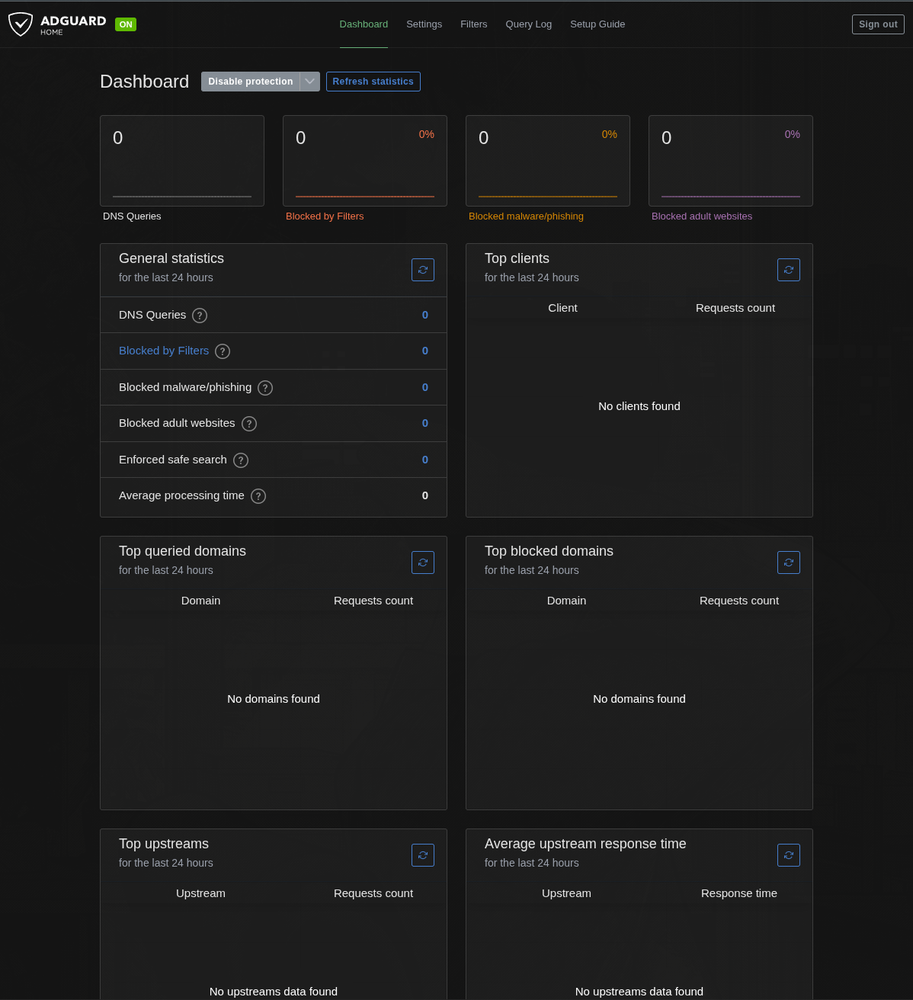
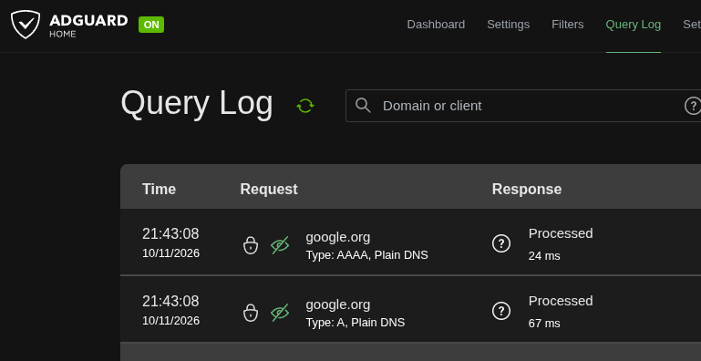

# AdGuard Home Homelab

A self-hosted DNS filtering project using **AdGuard Home** on a Raspberry Pi 5 to block unwanted domains, reduce tracking, and improve DNS visibility across a home network.

This project documents the installation, configuration, testing, and planned security hardening of a dedicated DNS filtering server.

## Overview

AdGuard Home acts as the DNS server for configured clients on the home network. DNS requests are forwarded to the Raspberry Pi, where configured blocklists filter known advertising and tracking domains.

### Goals

- Self-host DNS filtering on a Raspberry Pi.
- Configure the home network to use AdGuard Home.
- Block known advertising and tracking domains.
- Monitor DNS requests through the Query Log dashboard.
- Validate filtering from a Linux client.
- Document the architecture, configuration, and troubleshooting process.

## Hardware and Software

| Component | Configuration |
|---|---|
| Server | Raspberry Pi 5 |
| Operating system | Raspberry Pi OS Lite, 64-bit |
| DNS filtering | AdGuard Home |
| Installation method | Native installation, without Docker |
| Client | Ubuntu |
| Client network interface | `wlo1` |
| Server LAN IP | `192.*.*.*` |

## Network Architecture

The Raspberry Pi hosts AdGuard Home and receives DNS requests from configured clients. The router advertises the Raspberry Pi's IP address as the DNS server through DHCP.

```text
                Internet
                   |
             Home Router
                   |
             Home Network
                   |
          Raspberry Pi 5
          192.*.*.*
                   |
             AdGuard Home
                   |
          DNS filtering rules
                   |
          Allowed DNS responses
```

See [Network Architecture](diagrams/network-architecture.png) for the project diagram.

## Implemented Features

- [x] AdGuard Home installed on Raspberry Pi OS Lite.
- [x] Web dashboard accessible.
- [x] Raspberry Pi LAN address configured as `192.*.*.*`.
- [x] Router DHCP DNS option configured to advertise the Raspberry Pi.
- [x] DNS blocklists configured.
- [x] Omarchy Linux configured to use AdGuard Home.
- [x] DNS filtering validated using `doubleclick.net`.
- [x] DNS requests available for inspection in the Query Log.

## DNS Filtering Test

The following command was run on the Omarchy Linux client:

```bash
nslookup doubleclick.net
```

Observed result:

```text
Name:    doubleclick.net
Address: 0.0.0.0
Name:    doubleclick.net
Address: ::
```

**Result:** The domain returned blocked addresses instead of its normal public IP addresses.

The client uses `192.*.*.*` as its configured DNS server. The `127.0.0.53` address displayed by `nslookup` is the local `systemd-resolved` stub on Omarchy Linux.

See [DNS Validation](tests/dns-validation.md) for the test documentation.

## Screenshots

### AdGuard Home Dashboard



### DNS Query Test



## Repository Structure

```text
adguard-home-homelab/
├── README.md
├── docs/
│   ├── architecture.md
│   ├── installation.md
│   ├── configuration.md
│   ├── security-hardening.md
│   └── troubleshooting.md
├── diagrams/
│   └── network-architecture.png
├── screenshots/
│   ├── dashboard.png
│   └── dns-query-test.png
├── tests/
│   └── dns-validation.md
└── LICENSE
```

## Documentation

- [Architecture](docs/architecture.md)
- [Installation Guide](docs/installation.md)
- [Configuration Guide](docs/configuration.md)
- [Security Hardening](docs/security-hardening.md)
- [Troubleshooting](docs/troubleshooting.md)
- [DNS Validation Tests](tests/dns-validation.md)

## Security Considerations

- Keep AdGuard Home and the Raspberry Pi operating system updated.
- Restrict access to the administration interface to trusted devices.
- Use strong credentials for the dashboard.
- Keep blocklists maintained and review their impact on legitimate services.
- Remember that DNS filtering does not encrypt all internet traffic or guarantee that every advertisement is blocked.
- Other devices and applications may bypass the configured DNS server if they use alternative DNS settings or DNS-over-HTTPS.

## Future Improvements

- Complete and document security hardening.
- Validate DNS filtering from additional network devices.
- Capture and document final dashboard and blocklist screenshots.
- Expand testing for blocked and allowed domains.
- Review methods to reduce DNS bypass where supported by the router.

## Learning Outcomes

This project provides practical experience with:

- Linux system administration.
- DNS resolution and filtering.
- Network configuration and DHCP.
- Self-hosted infrastructure.
- Basic network troubleshooting.
- Technical documentation and validation.

## License

See the [LICENSE](LICENSE) file for license details.