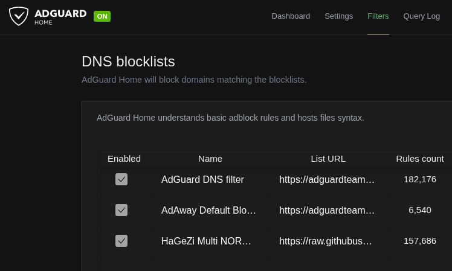

## 1. Initial Web Interface and DNS Configuration

### Objective

Configure the AdGuard Home administrator interface and DNS listener.

### Configuration

- **Installation method:** Native Linux installation
- **Platform:** Raspberry Pi 5 running Raspberry Pi OS Lite 64-bit
- **Web administration:** Configured through the initial setup wizard
- **DNS service:** Configured to listen on port 53
- **Administrator credentials:** Stored securely and excluded from Git

### Verification

The following commands are used to verify the service and listening ports:

```bash
sudo systemctl status AdGuardHome --no-pager
sudo ss -lntup | grep -E ':(53|3000)\b'
```

## 2. Router DHCP DNS Configuration

### Objective

Configure the router's DHCP server to advertise AdGuard Home as the DNS server for local network clients.

### Configuration

- **DHCP option:** Domain Name Server (Option 6)
- **DNS server:** Raspberry Pi running AdGuard Home
- **Configuration method:** Router DHCP IPv4 settings

### Validation

- [x] DHCP DNS option configured.
- [x] AdGuard Home receives DNS queries from network clients.
- [ ] DNS filtering tested with a known blocked domain.
- [ ] Client DNS behavior verified.


## 3. Expanded DNS Filtering

### Objective

Expand network-wide DNS filtering with the HaGeZi Multi NORMAL blocklist.

### Blocklist configuration

- **Name:** HaGeZi Multi NORMAL
- **Format:** AdBlock
- **Source:** https://raw.githubusercontent.com/hagezi/dns-blocklists/main/adblock/multi.txt
- **Purpose:** Additional filtering for advertising, tracking, telemetry, phishing, malware, and unwanted domains.

### Validation checklist

- [x] Blocklist added and enabled.
- [x] Blocklist update completed successfully.
- [x] Rule count verified.
- [x] Normal DNS resolution tested.
- [x] Previously blocked domain still blocked.
- [x] Other devices checked for unexpected breakage.

**Status:** Update after completing validation.

