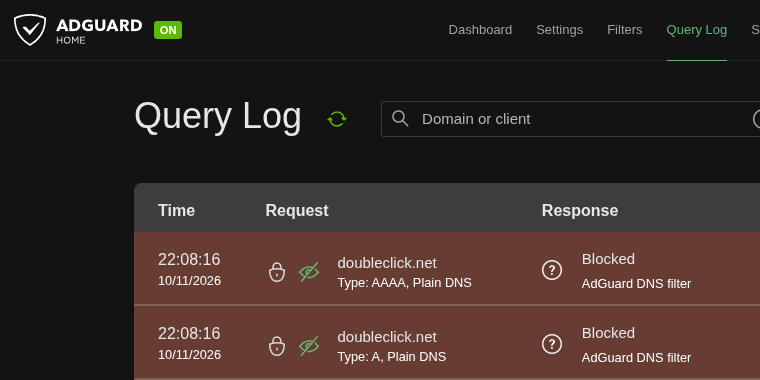

## 1. Initial DNS Resolution Test

### Objective

Verify that AdGuard Home responds to DNS queries from a client on the local network.

### Test command

Run from the client computer, replacing `PI_IP` with the Raspberry Pi's LAN IP address:

```bash
nslookup google.com PI_IP
```

### Expected result

- The DNS server corresponds to the Raspberry Pi.
- The query returns an IP address for `example.org`.
- The request appears in the AdGuard Home Query Log.

### Results

- [✓] DNS query completed successfully.
- [✓] Correct DNS server confirmed.
- [✓] Query visible in AdGuard Home Query Log.
- [✓] Screenshot saved as `screenshots/dns-query-test.png`.


## 2. DNS Filtering Validation

### Objective

Verify that AdGuard Home blocks a domain identified by its active DNS filtering rules.

### Test environment

- **Client:** Omarchy Linux
- **DNS server:** `192.168.*.*`
- **Test domain:** `doubleclick.net`

### Test command

```bash
nslookup doubleclick.net 192.168.*.*
```

### Observed result

```text
Server:  192.168.*.*
Address: 192.168.*.*#53

Name:    doubleclick.net
Address: 0.0.0.0
Address: ::
```




### Conclusion

The direct DNS query returned `0.0.0.0` for IPv4 and `::` for IPv6, indicating that AdGuard Home blocked the tested domain.

- [x] Direct query to AdGuard Home succeeded.
- [x] Blocked IPv4 response observed.
- [x] Blocked IPv6 response observed.


